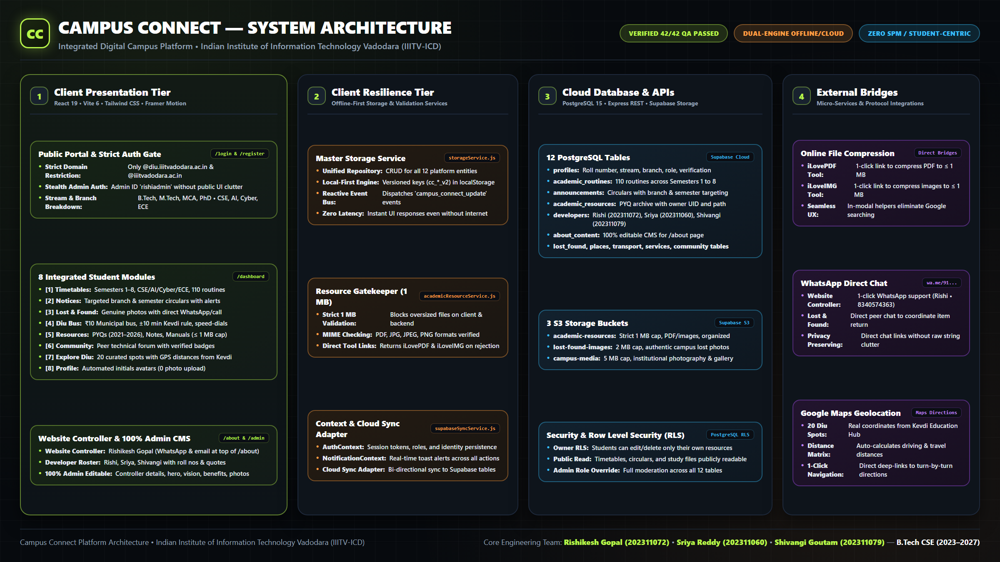
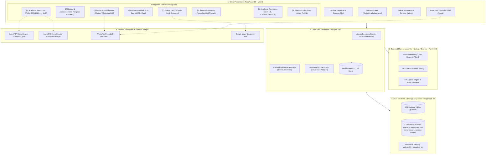
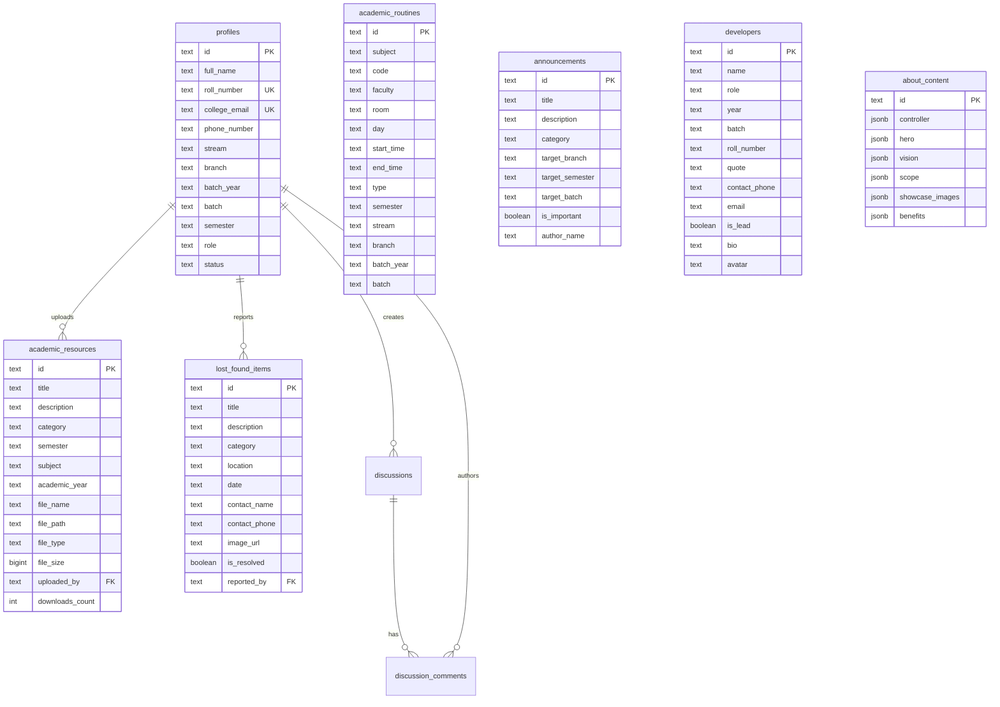
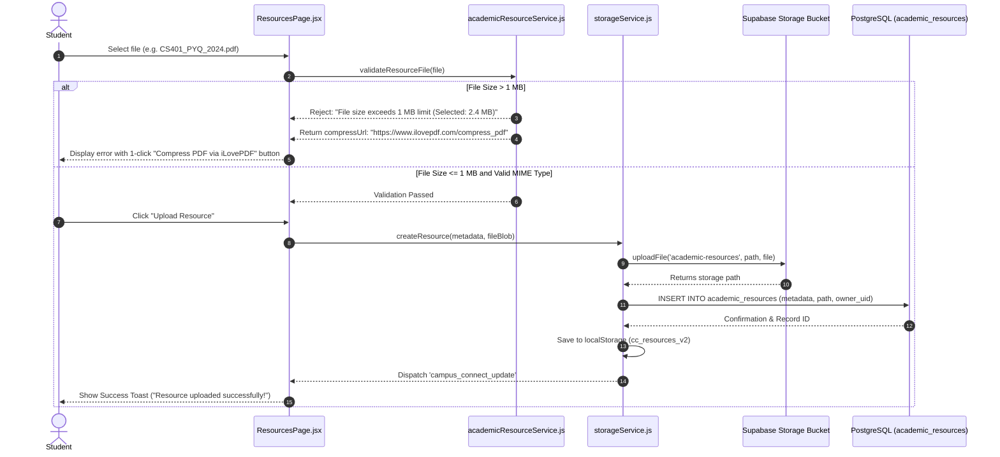

# Campus Connect — System Architecture & Technical Specification

> **Integrated Digital Campus Ecosystem for Student Information, Academic Coordination and Community Engagement**  
> Indian Institute of Information Technology Vadodara – International Campus Diu (IIITV-ICD)  
> **Core Engineering Team**: Rishikesh Gopal (`202311072`), Sriya Reddy (`202311060`), Shivangi Goutam (`202311079`) — *B.Tech CSE (2023–2027)*

---

## 1. High-Resolution Architecture Diagram

Below is the complete 5-tier system architecture diagram generated for **Campus Connect**, illustrating all layers from the React presentation layer down to the Supabase PostgreSQL cloud infrastructure and external compression/communication bridges:

---

## 2. Architectural Overview & Design Philosophy

Campus Connect is built as an **offline-first, student-centric progressive digital ecosystem** tailored exclusively for the student body and administration of IIIT Vadodara – International Campus Diu (Education Hub, Kevdi).

### Core Architectural Principles:
1. **Zero Bloat & Zero Academic Friction**: Unlike institutional ERPs with payroll, fee collection, or HR modules, Campus Connect is 100% focused on daily student workflows: lecture hall allocations, municipal bus timetables, authentic lost & found recovery, verified announcements, peer discussions, and crowdsourced study resources.
2. **Dual-Engine Resilience (Offline-First + Cloud Synchronization)**:
   - **Local Storage Engine**: Versioned local storage keys (`cc_*_v2`) guarantee that all timetables, saved resources, bus schedules, and tourist information remain accessible even in poor connectivity areas around Kevdi or Diu island.
   - **Supabase Cloud Engine**: PostgreSQL 15 database + S3-compatible storage buckets ensure data persistence, multi-device synchronization, and strict Row Level Security (RLS).
3. **Strict Domain Identity & Security**:
   - Only official institute email addresses ending with `@diu.iiitvadodara.ac.in` or `@iiitvadodara.ac.in` are permitted to create student accounts.
   - Admin access is protected via stealth identifier authentication (`rishiadmin`), keeping public student interfaces clean.
4. **Strict Resource Constraints**:
   - Academic resource uploads are restricted to a **1 MB maximum file size**.
   - Direct online compression tool bridges ([iLovePDF](https://www.ilovepdf.com/compress_pdf) and [iLoveIMG](https://www.iloveimg.com/compress-image)) are surfaced immediately upon oversized file detection so users can compress files without leaving the ecosystem.

---

## 3. Tier-by-Tier System Breakdown

---

## 4. Detailed Component Architecture

### Tier 1: Client Presentation Layer
* **Framework**: React 19 SPA bundled with Vite 6.
* **Styling & Theming**: Tailwind CSS with custom high-contrast dark theme:
  * Primary Accent: Neon Lime (`#B7F34A`)
  * Secondary Accent: Warm Orange (`#FF9F43`)
  * Deep Background: Obsidian Dark (`#0A0A0A`, `#121212`, `#161616`)
  * Typography: Clean sans-serif with monospace font for course codes (`CS401`), roll numbers (`202311072`), and room allocations (`Room 2118`).
* **Animation & Motion**: Framer Motion for subtle entry transitions, hover lifts, and glowing ambient halos.
* **Navigation Architecture**:
  * Public Layout: Top navigation bar, dynamic footer, landing page, and `/about`.
  * Dashboard Layout: Left sidebar (desktop + responsive mobile slide-out), sticky top nav with global search (`Ctrl+K`), and unread circular notifications.
  * Admin Console Layout: Dedicated management sidebar with 11 admin modules.

### Tier 2: Offline-First Client Adapter Layer
* **`storageService.js`**:
  * Unified CRUD repository handling 12 distinct entities.
  * Broadcasts reactive custom DOM events (`campus_connect_update`) whenever any entity changes, ensuring instant UI re-renders across split views.
* **`academicResourceService.js`**:
  * Validates file size (strictly $\le 1\text{ MB}$ or $1,048,576\text{ bytes}$).
  * Validates allowed MIME types: `application/pdf`, `image/jpeg`, `image/png`.
  * Returns structured error payloads containing dynamic 1-click links to `iLovePDF` or `iLoveIMG` if a file is rejected.
* **`supabaseSyncService.js`**:
  * Dual-mode environment detection (browser `import.meta.env` + Node.js `process.env`).
  * Cloud table query executor, upsert handlers, and multi-file storage upload engine.

### Tier 3: Backend API & Microservices Layer
* **Server**: Node.js 20+ runtime with Express 4.
* **Port**: `5000` (runs concurrently with frontend on `5173`).
* **Security & Auth**:
  * `authMiddleware.js` verifies JWT bearer tokens.
  * Role-Based Access Control (RBAC): enforces `role === 'admin'` on administrative endpoints.
* **API Endpoints**:
  * `/api/auth`: Login, registration, token refresh, roll number validation.
  * `/api/routines`: Academic routine CRUD, branch/semester filters.
  * `/api/announcements`: Circulars, targeted audience dispatch.
  * `/api/resources`: Study materials upload, download counters.
  * `/api/lost-found`: Lost/found listings, claim status updates.
  * `/api/transport`: ₹10 municipal bus stops, student speed-dials.
  * `/api/developers`: Team roster management.

---

## 5. Cloud Database Schema (Supabase PostgreSQL 15)

The database schema is defined in [supabase_schema.sql](./campus-connect/supabase_schema.sql) and contains **12 relational tables** and **3 storage buckets**:

### Storage Buckets & Policies:
1. **`academic-resources`**:
   - Max file size: $1\text{ MB}$ ($1,048,576\text{ bytes}$).
   - Allowed MIME types: `application/pdf`, `image/jpeg`, `image/png`.
   - Access: Public read; authenticated student write; owner-only delete (`auth.uid() = (storage.foldername(name))[1]` or table owner).
2. **`lost-found-images`**:
   - Max file size: $2\text{ MB}$.
   - Allowed MIME types: Images only (`image/*`).
3. **`campus-media`**:
   - Max file size: $5\text{ MB}$.
   - Institutional campus photography and showcase gallery assets.

---

## 6. End-to-End Data Flow Sequence

The sequence diagram below illustrates how an academic resource is validated, uploaded, and synchronized:

---

## 7. Technology Stack Summary

| Layer | Technologies / Packages | Purpose |
| :--- | :--- | :--- |
| **Frontend Framework** | React 19, Vite 6 | Lightning-fast component rendering & HMR |
| **Styling & Design** | Tailwind CSS 3.4, Lucide React, Framer Motion | High-contrast dark theme, micro-interactions, responsive mobile views |
| **State & Local Persistence** | React Context API, Web LocalStorage (`cc_*_v2`) | Offline-first zero latency data operations |
| **Backend Runtime** | Node.js 20+, Express 4 | REST API services & authentication routing |
| **Cloud Database** | Supabase Cloud, PostgreSQL 15 | Relational data integrity, foreign keys, triggers |
| **Security & Authorization** | Row Level Security (RLS), JWT Tokens | Tenant isolation, ownership protection, admin elevation |
| **Cloud Storage** | Supabase Storage (S3-compatible) | Binary asset hosting with strict size & MIME gatekeeping |
| **Compression Utilities** | iLovePDF, iLoveIMG | External micro-service bridges for file size optimization |
| **Communication Bridges** | WhatsApp Deep Linking (`wa.me`), Mailto Protocol | Instant 1-click student contact with Website Controller |
