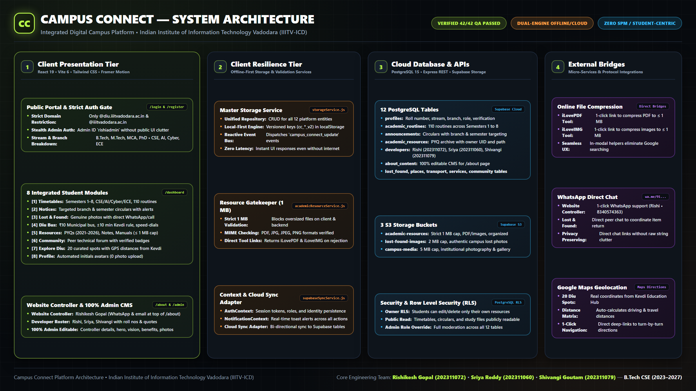

# 🎓 Campus Connect

> **"Your Campus. Everything Connected."**  
> **Integrated Digital Campus Ecosystem for Student Information, Academic Coordination and Community Engagement**  
> Developed for **Indian Institute of Information Technology Vadodara – International Campus Diu (IIITV-ICD)**.

[](https://react.dev/)
[](https://vitejs.dev/)
[](https://tailwindcss.com/)
[](https://supabase.com/)
[](https://nodejs.org/)
[](LICENSE)

---

## 🏛️ System Architecture Diagram



> **Detailed Specification:** For the complete in-depth architectural breakdown, see [Campus_Connect_Architecture_Specification.md](./Campus_Connect_Architecture_Specification.md) or download the presentation-ready [Architecture Specification PDF](./Campus_Connect_Architecture_Specification.pdf).

---

## 👥 Core Engineering Team

* **Institute:** Indian Institute of Information Technology Vadodara – International Campus Diu (Education Hub, Kevdi, Diu UT – 362520)
* **Program & Batch:** B.Tech in Computer Science & Engineering (2023–2027)

| Name | Roll Number | Role | Key Contributions |
|---|---|---|---|
| **Rishikesh Gopal** | `202311072` | **Project Controller & Full-Stack Lead** | Full-stack architecture, Supabase schema design & RLS, Auth gate, Admin Controller CMS, offline sync engine |
| **Sriya Reddy** | `202311060` | **Frontend Architect & UI/UX Designer** | Editorial design system (Monochrome + Lime), responsive layout, animations, Academic Resources UI |
| **Shivangi Goutam** | `202311079` | **Backend & Data Persistence Engineer** | Express API endpoints, Supabase storage integration, compression pipeline, automated QA test suite |

---

## 🎯 Problem Statement & Solution

Students at modern satellite campuses frequently face fragmented communication across unorganized WhatsApp groups, paper notice boards, word-of-mouth bus timings, and scattered cloud drives.

**Campus Connect** centralizes everyday campus life into one unified progressive web platform:
1. **Academic Routines & Timetables**: Complete semester timetables (Sem 1 to Sem 8) across CSE, AI, Cyber Security, and ECE with active class highlights and room allocations.
2. **Notices & Circulars**: Official announcements filtered by target semester and batch with priority alerts.
3. **Academic Resources Hub**: Curated repository for PYQs (2021–2026), lecture notes, lab manuals, and study guides with strict 1 MB validation and in-app compression bridges ([iLovePDF](https://www.ilovepdf.com/compress_pdf) & [iLoveIMG](https://www.iloveimg.com/compress-image)).
4. **Lost & Found Network**: Real-time listing with photo attachments and direct student WhatsApp/phone claim actions.
5. **Diu Transport Hub**: Comprehensive schedule covering Diu City Stand, Ghoghla, Education Hub Kevdi, Diu Airport, and Una Junction with bus numbers and driver contacts.
6. **Community Forum**: Thread-based peer discussions with upvoting and real-time replies.
7. **Diu Local Explorer**: Curated guide to campus landmarks, beaches, forts, and emergency contacts with Google Maps integration.
8. **Admin Controller CMS & About Page**: Dynamic admin panel allowing instant editing of the About Us page, institute leadership, team members, and controller profiles.

---

## 🛠️ Technology Stack

| Layer | Technologies |
|---|---|
| **Frontend** | React 19, Vite 6, Tailwind CSS, Lucide React, Canvas Confetti |
| **Backend** | Node.js, Express.js (REST API on port 5000) |
| **Database & Cloud Storage** | Supabase (PostgreSQL 15), Supabase Storage (3 buckets: `academic-resources`, `lost-found`, `campus-images`), Row Level Security (RLS) |
| **Persistence Strategy** | Dual-Engine: Versioned Local Storage (`cc_*_v2`) for offline resilience + Supabase Cloud Sync |
| **External Bridges** | [iLovePDF](https://www.ilovepdf.com/compress_pdf), [iLoveIMG](https://www.iloveimg.com/compress-image) (instant file size optimization) |

---

## 🗄️ Database Schema & Storage

The production PostgreSQL database contains **12 relational tables** and **3 storage buckets** defined in [supabase_schema.sql](./campus-connect/supabase_schema.sql):

1. `profiles` — Student & admin user profiles with role-based policies
2. `academic_resources` — Study materials metadata with 1 MB limit and ownership RLS
3. `notices` — Official circulars with semester targeting
4. `academic_routines` — Weekly class timetables by semester and branch
5. `lost_found_items` — Lost and found item directory with image references
6. `community_posts` — Forum discussions with upvote counters
7. `community_comments` — Real-time comments on forum posts
8. `bus_schedules` — Transport routes, stops, and driver contact info
9. `campus_places` — Local Diu landmarks and facility guide
10. `about_cms` — Content management table for the About Us page
11. `about_team` — Dynamic team member showcase editable via admin
12. `about_controller` — Project controller leadership profile editable via admin

**Storage Buckets**:
- `academic-resources` — Maximum 1 MB per file; PDF, JPG, PNG allowed
- `lost-found` — Item photos
- `campus-images` — Campus photos and about page assets

---

## 🚀 Quick Start Guide

### Prerequisites
- **Node.js**: v18.0 or higher
- **npm**: v9.0 or higher

### Installation & Execution

```bash
# 1. Clone the repository
git clone https://github.com/rishi12145/Campus-Connect.git
cd Campus-Connect

# 2. Install dependencies
npm run install:all

# 3. Start the Frontend Development Server (Port 5173)
npm run dev

# 4. (Optional) Start the Backend Express Server (Port 5000)
npm run start:backend
```

Open your browser at:  
👉 **`http://localhost:5173/`**

---

## 🔑 Demo Access Credentials

| Role | Email / Identifier | Password | Quick Access |
|---|---|---|---|
| **Student** | `student@campus.com` | `student123` | Click **"Demo Student"** on login screen |
| **Administrator** | `admin@campus.com` | `admin123` | Click **"Demo Admin"** on login screen |

---

## 🧪 Automated QA & Integration Testing

A comprehensive 42-point test suite validates all modules, routes, compression limits, and database operations:

```bash
node test_suite.js
```
**Status**: `42 passed, 0 failed (100% pass rate)`

---

## 📄 Documentation Deliverables

- [Campus_Connect_Architecture_Diagram.png](./Campus_Connect_Architecture_Diagram.png) — Ultra-high resolution 16:9 2K presentation slide
- [Campus_Connect_Architecture_Specification.md](./Campus_Connect_Architecture_Specification.md) — Comprehensive technical architecture specification
- [Campus_Connect_Architecture_Specification.pdf](./Campus_Connect_Architecture_Specification.pdf) — Presentation-ready PDF report
- [Campus_Connect_Architecture_Specification.html](./Campus_Connect_Architecture_Specification.html) — Interactive HTML architecture document
- [supabase_schema.sql](./campus-connect/supabase_schema.sql) — Complete 12-table DDL schema with RLS policies and storage bucket configuration

---

## 📜 License

Distributed under the MIT License. See `LICENSE` for more information.
